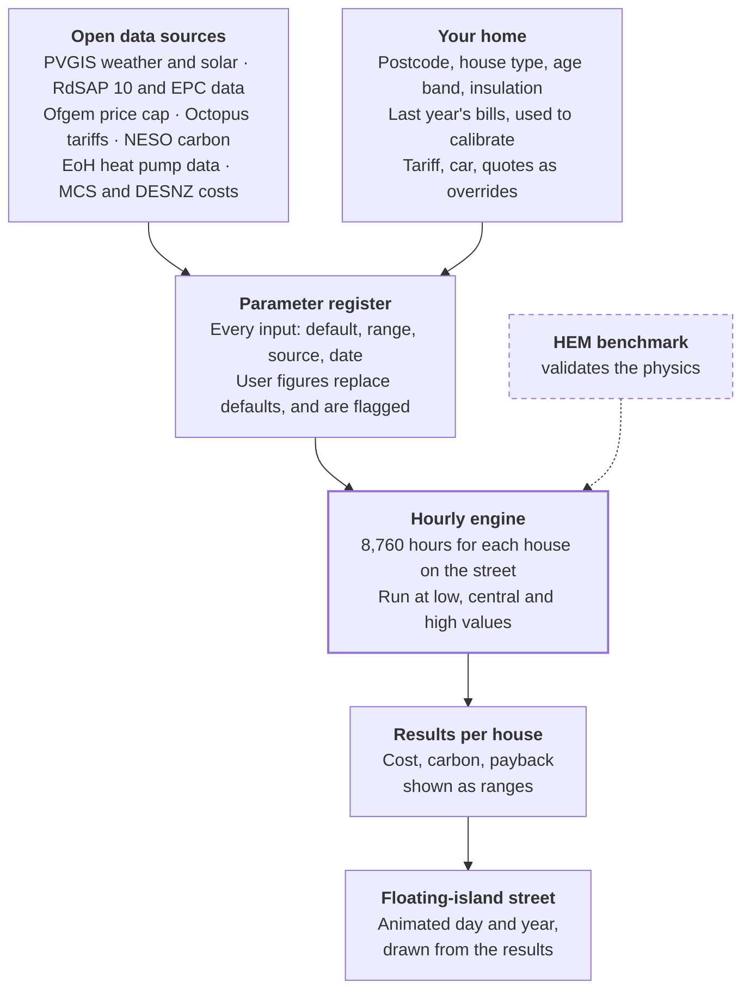

# Home energy simulator: parameter register and model spec

2026-10-17 · Magnus Hultberg

> This file is the canonical copy. It was exported on 2026-10-17 from Magnus's private Claude Docs original, which other readers can't open: https://claude.ai/code/artifact/e2644006-20de-4ea0-8655-8d3575f52393

## Purpose and the bar for trust

The simulator lets a homeowner in England compare whole-house setups side by side, so they can see which upgrades save money and carbon for their kind of home, and in what order. A setup is a house plus its kit: gas boiler or heat pump, solar, battery, EV, insulation, glazing, tariff.

"Trustworthy" means three testable things:

1. **Right on the decision.** For a given house, the model ranks options the way measured data would. For example, it should show that a heat pump only beats gas on running cost when it is on a suitable tariff, or when the fabric is decent.
2. **Honest about uncertainty.** Outputs are ranges (low, central, high), not single numbers. The range widens when the user relies on defaults, and narrows when they enter their own bills.
3. **Transparent.** Every number in the model comes from the parameter register. Each entry has a source, a range and a last-checked date, and the user can override it.

Scope for v1 is owner-occupied houses in England. Wales and Scotland follow in a later phase. Flats, Northern Ireland and commercial buildings are out of scope.

## Model architecture

The engine is an hourly energy balance run over one typical year (8,760 steps) for every house on the street. It is a simplified, hourly cousin of the government's own models, so its physics can be checked against them.

**Reference models to stay aligned with.** SAP and its survey version RdSAP produce today's EPCs. They are being replaced by the Home Energy Model (HEM), which DESNZ publishes as open-source Python and which [runs at a finer time resolution than SAP, based on BS EN ISO 52016-1](https://www.elmhurstenergy.co.uk/blog/2025/10/02/desnz-release-home-energy-model-consultation-response/). HEM takes [about a minute per simulation](https://www.cibsejournal.com/?p=32373), too slow for a live slider-driven UI. So the plan is: run our fast engine in the browser, and use HEM offline as a benchmark to check our archetypes against.

**Each hour, for each house:**

1. **Heat loss coefficient (fixed per house).** Fabric plus ventilation:

```latex
H = \sum_i U_i A_i + 0.33 \, n \, V
```

H is in W/K. U and A are each element's U-value and area, n is air changes per hour and V is heated volume in m³.

2. **Space heat demand.** Heat lost minus free gains from sun, people and appliances:

```latex
Q_{heat}(t) = \max\big(0,\; H\,(T_{set}(t) - T_{out}(t)) - G_{solar}(t) - G_{internal}(t)\big)
```

3. **Hot water demand** from occupancy and a daily draw profile.
4. **Heat supply.** Gas: fuel = heat ÷ boiler efficiency. Heat pump: electricity = heat ÷ COP(T\_out, flow temperature).
5. **Electricity balance.** Household base load + heat pump + EV charging − solar generation. A battery charges or discharges under simple rules: soak up surplus solar, charge in cheap windows, discharge at peak.
6. **Cost and carbon.** Grid import × that hour's tariff rate, minus export × export rate, plus standing charges. Carbon = import × that hour's grid intensity, plus gas × gas factor.

**Outputs per house:** annual cost, kWh by fuel, carbon, capital cost, net cost after grants, and simple payback against the baseline house. Every output is computed three times (low, central, high) by running the parameter ranges through the same engine.

**Every number flows through one register before the engine uses it.**



The visualisation only ever reads results; it never computes anything itself, so polishing it can't change the numbers.

## How the register works

> The row format below is the original idea. It is superseded by the [typed parameter register ADR](../../REFERENCE/decisions/2026-10-17-typed-parameter-register.md), which adds typed row kinds and lets approximate rows carry a rationale instead of a source. Phase 1 values, such as the SPF distribution, are in the [phase 1 spec](../ARCHIVE/01-engine-core.md).

Every input the engine reads is one row in the register, and nothing is hard-coded elsewhere. Each row carries these fields:

| Field | What it holds | Example |
| --- | --- | --- |
| ID | Stable machine name | `hp.spf.central` |
| Default | The value used when the user knows nothing | 2.8 |
| Range (low / high) | Plausible spread, drives the uncertainty band | 2.3 / 3.6 |
| Unit | Always explicit | dimensionless |
| Source | Link to the document or dataset | EoH final report |
| Last checked | Date someone verified it | 2026-10-17 |
| Refresh cadence | How often it goes stale | Quarterly / yearly / static |
| Overridable | Can the user replace it, and with what | Yes: SCOP of their chosen model |
| Depends on | Other rows it is derived from | `weather.region` |

The register lives as a versioned data file in the repo. The UI reads the same file to show "where does this number come from?" next to every input. Status values used in the tables below: **Sourced** (verified today with a link), **To verify** (a known source exists but the exact figure still needs pulling), **Approximate** (engineering estimate, needs a source).

## Register 1: location, weather and solar

One free source covers both weather and solar: the EU's PVGIS service. Its typical-meteorological-year endpoint returns a full hourly year (temperature, irradiance, wind) for any coordinates, and its `seriescalc` endpoint returns [hourly PV output for a given system size and orientation](https://joint-research-centre.ec.europa.eu/photovoltaic-geographical-information-system-pvgis/using-pvgis-5/api-non-interactive-service_en). Fetching one typical year per postcode district and caching it keeps the browser fast.

| Parameter | Default | Range | Source | Override | Status |
| --- | --- | --- | --- | --- | --- |
| Location | Postcode district centroid | — | User input | Exact postcode | — |
| Hourly outdoor temperature | PVGIS typical year for location | Mild / typical / cold year | [PVGIS API v5.3 (`tmy`)](https://joint-research-centre.ec.europa.eu/photovoltaic-geographical-information-system-pvgis/using-pvgis-5/api-non-interactive-service_en) | — | Sourced |
| Hourly solar irradiance | PVGIS typical year | As above | [PVGIS API v5.3](https://joint-research-centre.ec.europa.eu/photovoltaic-geographical-information-system-pvgis/using-pvgis-5/api-non-interactive-service_en) | — | Sourced |
| PV output per kWp | PVGIS `seriescalc` with system size, tilt, azimuth | ±10% | [PVGIS hourly service via pvlib docs](https://pvlib-python.readthedocs.io/en/stable/reference/generated/pvlib.iotools.get_pvgis_hourly.html) | Roof pitch, orientation, shading | Sourced |
| System losses (inverter, cabling, soiling) | 14% | 10–18% | PVGIS default | Installer's figure | Approximate |
| Design (coldest) outdoor temperature | Regional design value | — | [MCS Heat Load Calculator design conditions](https://heatloadcalculator.mcscertified.com/docs/reference-sources/design-conditions) | — | To verify |

Note for the cold-snap view: a typical year smooths out extremes. For the "January week" animation, also cache one recent cold year so people can see how a heat pump copes in a real freeze.

## Register 2: housing stock and fabric

The fabric defaults should come straight from the RdSAP 10 specification, the same lookup tables EPC assessors use. MCS's own open heat-loss calculator already does exactly this and documents which table each value comes from, so we can mirror its approach rather than invent one.

**House archetype** = type (detached, semi, end-terrace, mid-terrace, bungalow) × age band × floor area. Geometry (wall, roof, floor and window areas) is derived from type and floor area using RdSAP's dimension conventions. The real distribution of types, ages and wall constructions per area can be drawn from the [EPC open data service](https://www.api.gov.uk/mhclg/energy-performance-certificates-domestic-buildings-search-api/), which holds [almost 30 million certificates for England and Wales](https://dluhcdigital.blog.gov.uk/2024/01/29/changes-to-the-energy-performance-certificates-open-data-service/). A user can also look up their own EPC and pre-fill the form from it.

| Parameter | Default | Source | Override | Status |
| --- | --- | --- | --- | --- |
| External wall U-value | By wall type × RdSAP age band | [RdSAP 10, England wall table](https://heatloadcalculator.mcscertified.com/docs/reference-sources/u-values) | Insulated yes/no, or a measured U-value | To verify (pull table) |
| Roof / loft U-value | By loft insulation thickness or age band | [RdSAP 10 Tables 16–18](https://heatloadcalculator.mcscertified.com/docs/reference-sources/u-values) | Thickness in mm | To verify (pull table) |
| Window U-value | By glazing type, frame and age | [RdSAP 10 Tables 24–25](https://heatloadcalculator.mcscertified.com/docs/reference-sources/u-values) | Single / double / triple, frame | To verify (pull table) |
| Floor U-value | By construction, insulation, age band | [RdSAP 10 §5.12](https://heatloadcalculator.mcscertified.com/docs/reference-sources/u-values) | Suspended timber / solid, insulated | To verify |
| Door U-value | By age band | [RdSAP 10 Table 26](https://heatloadcalculator.mcscertified.com/docs/reference-sources/u-values) | — | To verify |
| Air changes per hour | By age band and draught-proofing | [MCS ventilation rates](https://heatloadcalculator.mcscertified.com/docs/reference-sources/ventilation-rates) | Draught-proofed yes/no; blower-door result | To verify |
| Thermostat setpoint | 20°C living, lower elsewhere | Approximate (SAP-style) | User's thermostat setting | Approximate |
| Heating schedule | Morning + evening blocks | Approximate | Hours the heating runs | Approximate |
| Occupants | From floor area | SAP occupancy formula | Number of people | To verify |
| Hot water use | From occupants | SAP / HEM draw profiles | Showers per day | To verify |
| Base electricity (lights, appliances) | From floor area and occupants | Approximate; check against Ofgem typical consumption | Last year's electricity use | Approximate |

**Known bias to correct for.** Field measurements have repeatedly found solid walls lose heat more slowly than RdSAP's old default assumed. BRE's own review found the default solid-wall U-value of 2.1 W/m²K [was pessimistic by around a quarter](https://bregroup.com/documents/d/bre-group/consp-16-wall-u-values-for-existing-dwellings-v1_0-pdf). An overly leaky default would overstate the savings from wall insulation, which is exactly the kind of error that destroys trust. Use the latest RdSAP 10 values and treat older-solid-wall U-values as wide ranges.

## Register 3: heating systems

Heat pump efficiency is the single most consequential number in the model, and there is good UK field data for it. The default must come from measured homes, not brochures. Design figures run well ahead of reality: an analysis of about 1,700 monitored RHI installs found [the gap between mean design SCOP and mean in-situ SPF had grown to 1.04](https://www.recc.org.uk/news/new-data-analysis-provides-evidence-on-in-situ-heat-pump-performance) for air source heat pumps installed in 2022.

**Three anchors for heat pump performance:**

- **Central: Electrification of Heat trial.** The government-funded demonstration in ordinary British homes found a [median seasonal performance factor of 2.80 for air source heat pumps](https://es.catapult.org.uk/news/heat-pumps-shown-to-be-three-times-more-efficient-than-gas-boilers/), and performance was [only marginally affected by cold weather](https://current-news.co.uk/heat-pumps-proven-to-be-three-times-more-efficient-than-gas-boilers).
- **Spread: RHI monitoring data.** [Nearly 30% of ASHPs reached SPF 3.0 or above, and 8% reached 3.5](https://www.recc.org.uk/news/new-data-analysis-provides-evidence-on-in-situ-heat-pump-performance).
- **What good looks like: HeatpumpMonitor.org.** Well-designed, enthusiast-monitored systems average [around SPF 4.0](https://community.openenergymonitor.org/t/electrification-of-heat-trial-data/27445). This is a self-selected sample, so it is an upper bound for a "well installed" option, not a default.

| Parameter | Default | Range | Source | Override | Status |
| --- | --- | --- | --- | --- | --- |
| ASHP seasonal performance (SPF) | 2.8 | 2.3–4.0 | EoH trial; RHI data; HeatpumpMonitor (above) | Chosen model's SCOP, discounted toward field data | Sourced (low end to verify) |
| ASHP COP vs outdoor temp | Curve scaled to hit the SPF above | — | EoH datasets (UK Data Service) | Manufacturer data at 35/45/55°C flow | To verify |
| Flow temperature | 45°C | 35–55°C | Approximate | "Radiators upgraded?" yes/no | Approximate |
| Gas boiler seasonal efficiency | 85% | 80–90% | Approximate; check product database (PCDB) | Boiler model or age | Approximate |

The heat pump override should never take a brochure SCOP at face value. Apply the field-measured discount so a user can't accidentally make the model optimistic.

## Register 4: solar and home battery

Solar output itself comes from PVGIS (Register 1); this section covers the kit. Battery dispatch rules live in the engine, not here.

| Parameter | Default | Range | Source | Override | Status |
| --- | --- | --- | --- | --- | --- |
| PV system size | 4 kWp | 2–8 kWp | Typical UK domestic | Panel count × wattage | Approximate |
| Battery usable capacity | 5 kWh | 3–15 kWh | Typical domestic range | Specific product | Approximate |
| Battery round-trip efficiency | 90% | 85–95% | Approximate; check spec sheets | Specific product | Approximate |

## Register 5: electric vehicle

The EV matters to the house only as a charging load: how many kWh it pulls from the home each week, and when. That is why it sits in a house simulator at all, and it pairs naturally with time-of-use tariffs and a home battery.

| Parameter | Default | Range | Source | Override | Status |
| --- | --- | --- | --- | --- | --- |
| EV battery and efficiency | By car model | — | [Open EV Data](https://github.com/KilowattApp/open-ev-data) (usable kWh, kWh/100 km) | Pick the car | Sourced |
| Weekly mileage | 140 miles | — | Approximate; check DfT National Travel Survey | User's miles | Approximate |
| Home-charging share | 80% | 50–100% | Approximate | User input | Approximate |
| Charging window | Overnight | — | Approximate | Times, or "follow cheapest slots" | Approximate |

The original Open EV Data project [has been folded into the paid Chargeprice API](https://ost.ecosyste.ms/projects/20152), so use a maintained fork or curate our own list of the 30 most common UK EVs.

## Register 6: energy prices, tariffs and carbon

The default tariff is the Ofgem price cap, and specific tariffs come from the Octopus public API. From 1 October to 31 December 2026 the cap averages [26.32p/kWh and 54.83p/day for electricity, and 7.97p/kWh and 29.68p/day for gas](https://ofgem.gov.uk/your-energy-supply/your-energy-bill/energy-price-cap-unit-rates-and-standing-charges), paying by Direct Debit. Those figures [include 5% VAT on gas; electricity carries no VAT from October 2026 to March 2027](https://ofgem.gov.uk/your-energy-supply/your-energy-bill/energy-price-cap-unit-rates-and-standing-charges). Rates also vary by region, so the register stores Ofgem's regional table for England's regions, not just the average.

| Parameter | Default | Source | Refresh | Override | Status |
| --- | --- | --- | --- | --- | --- |
| Electricity unit rate (flat) | 26.32 p/kWh | [Ofgem price cap, Oct–Dec 2026](https://ofgem.gov.uk/your-energy-supply/your-energy-bill/energy-price-cap-unit-rates-and-standing-charges) | Quarterly | Supplier + tariff | Sourced |
| Electricity standing charge | 54.83 p/day | As above | Quarterly | As above | Sourced |
| Gas unit rate | 7.97 p/kWh | As above | Quarterly | As above | Sourced |
| Gas standing charge | 29.68 p/day | As above | Quarterly | As above | Sourced |
| Time-of-use tariffs (Agile, Go, Cosy, Tracker) | Half-hourly rate schedule | [Octopus REST API](https://developer.octopus.energy/docs/api/), public product and unit-rate endpoints | Daily (Agile), on change (others) | Pick tariff | Sourced |
| Other suppliers' tariffs | Manual entry | Supplier websites | On change | Peak / off-peak rates and times | To verify |
| Export rate | Flat SEG rate | Supplier export tariffs | On change | User's export tariff | To verify |
| Grid carbon intensity | Hourly profile for a typical year (deferred beyond v1; v1 uses an annual factor) | [NESO Carbon Intensity API](https://carbonintensity.org.uk/) | Yearly rebuild | — | Sourced |
| Gas carbon factor | \~0.18 kgCO₂e/kWh | DESNZ GHG conversion factors | Yearly | — | Approximate |
| Future price path | Flat at today's cap | — | — | "Prices rise X% a year" slider | Approximate |

Four modelling notes:

- **Agile is day-ahead.** Octopus [usually publishes the next day's Agile rates by 4pm UK time](https://octo-api.readthedocs.io/en/stable/api/api.html). For a whole-year simulation, use the last 12 months of actual Agile rates as the "typical year", not a forecast.
- **Cosy and similar tariffs** use the same unit-rate endpoint as Agile, which [returns a rate per half-hour](https://community.openenergymonitor.org/t/live-octopus-cosy-price/25217). One code path handles all time-of-use tariffs.
- **Carbon.** The API's [regional figures are forecasts only; settled actuals exist nationally](https://apify.com/arman-bd/uk-carbon-intensity-scraper). Use national historic actuals to build the typical-year profile.
- **Prices move a lot.** Analysts were already [predicting a further 12–14% rise in January 2027](https://moneytothemasses.com/news/energy-bills-to-rise-by-4-from-october-with-14-rise-predicted-for-january). Payback should be shown under a few price scenarios, since a single figure implies more certainty than exists.

## Register 7: capital costs and grants

Capital costs are the least certain inputs, so they get the widest ranges and the most prominent "paste your quote" override. Official MCS-derived data exists for solar; heat pump and battery costs still need a primary source pulled.

| Parameter | Default (central) | Range | Source | Override | Status |
| --- | --- | --- | --- | --- | --- |
| Solar PV installed cost | \~£1,565 per kWp (England) | Regional; smaller systems cost more per kWp | MCS average [reported for April 2026](https://www.theecoexperts.co.uk/?p=1810); primary dataset: [DESNZ Solar PV cost data](https://www.data.gov.uk/dataset/solar-pv-cost-data) | Installer quote | To verify (pull DESNZ file) |
| Home battery installed cost | \~£4,500 for \~5 kWh | £3,000–£6,000 added to a solar install | [Trade pricing guide](https://www.trade2base.com/blog/solar-panel-installation-costs-uk) | Installer quote | Approximate |
| Air source heat pump installed cost | \~£13,000 before grant | £8,000–£20,000 | Government grant-scheme mean costs of [£15,300–£19,900 per ASHP](https://westminsterbrief.co.uk/archive/pq/1883) (includes wider works); BUS statistics to pull | Installer quote | To verify |
| Boiler Upgrade Scheme grant | £7,500 | £9,000 off-gas (oil/LPG) until 31 Mar 2027 | [Energy Saving Trust](https://www.energysavingtrust.org.uk/grants-and-schemes/boiler-upgrade-scheme/); [GOV.UK grant notice](https://www.gov.uk/government/publications/boiler-upgrade-scheme-regulations-approved-standards-grant-categories-and-grant-levels/notice-of-approved-grant-categories-and-values-for-the-boiler-upgrade-scheme) | — | Sourced |
| Replacement gas boiler (baseline) | \~£3,000 | £2,000–£4,500 | Approximate | Installer quote | Approximate |
| Loft insulation top-up | Approximate, per m² | — | Approximate; check Energy Saving Trust | User quote | Approximate |
| Cavity / solid wall insulation | Approximate, per m² | — | Approximate; check Energy Saving Trust | User quote | Approximate |
| Window upgrade | Approximate, per window | — | Approximate | User quote | Approximate |
| Equipment lifetimes | ASHP 15–20 yr, boiler 12–15, PV 25, battery 10–15 | — | Approximate | — | Approximate |

**Grant rules the model must encode.** The BUS gives [up to £7,500 in England and Wales](https://www.energysavingtrust.org.uk/grants-and-schemes/boiler-upgrade-scheme/), with a [temporary £9,000 for off-gas homes on oil or LPG from 21 July 2026 to 31 March 2027](https://www.energysavingtrust.org.uk/grants-and-schemes/boiler-upgrade-scheme/). It requires an MCS-certified installer, and the installer deducts it from the quote. It [does not apply in Scotland](https://switchtogether.co.uk/resource-hub/blog/boiler-upgrade-scheme), which only matters once we expand beyond England. Grants change often, so this row gets a monthly check.

## User overrides and calibration

Inputs are layered so anyone gets a result in under a minute, and every extra fact they add narrows the uncertainty band. The UI should show the band shrinking as they go, which is itself a reason to keep adding detail.

1. **Defaults only (10 seconds).** Postcode, house type, age band, bedrooms. Uses archetype defaults, widest band.
2. **Quick facts (1 minute).** Loft insulation yes/no, wall insulation yes/no, glazing type, current heating system, number of occupants. Or: pull these from the home's EPC.
3. **Calibration from bills (the big one).** Last year's gas kWh and electricity kWh, from a bill or app. The engine adjusts behaviour parameters (setpoint and heating hours) until modelled gas use matches actual gas use, within the plausible range for each. Every scenario on the street is then re-run on the calibrated house. Octopus customers can go further: their API key unlocks [half-hourly smart meter consumption](https://github.com/api-evangelist/octopus-energy), which calibrates the daily profile too.
4. **Specifics (optional, for the keen).** Exact tariff, a specific heat pump model, their car and weekly miles, PV roof orientation, installer quotes for each upgrade.

**Guardrails on overrides.** Overrides are accepted but sanity-checked against the register range. A heat pump SCOP of 5.0 or a loft U-value of 0.05 gets a gentle warning and is shown as "your figure" in the results, so the user can see which numbers are theirs.

**Calibration has limits.** If modelled and actual use differ by more than about 40% even after adjusting behaviour, the fabric assumptions are probably wrong. The tool should say so and suggest the most likely culprit (for example, "your house may be better insulated than a typical 1930s semi") rather than silently forcing a fit.

## Validation plan and known limitations

The model earns trust by being checked against independent references and by publishing the results. The site launches first as a public beta, a proof of concept; these checks follow the launch and do not gate it.

| Check | What it tests | Pass bar (proposed) |
| --- | --- | --- |
| Real homes with known bills (10–20 volunteers) | Annual gas and electricity, uncalibrated defaults | Within ±25% for most homes; ranks options the same way as their actual experience |
| HEM benchmark runs for each archetype | Physics of our simplified engine | Annual space heat within ±15% of HEM |
| Heat pump homes from the EoH datasets | Heat pump electricity use given the house and weather | Modelled SPF distribution matches the trial's |
| Ofgem typical consumption | Defaults for an average home | Archetype "typical" lands near Ofgem's typical household |
| Expert review | Assumptions in this register | A retrofit assessor and a heat pump installer sign off, with comments logged against rows |

**Limitations to state openly in the UI:**

- One heated zone per house. Rooms that are colder or unheated are only approximated.
- No modelling of damp, comfort or overheating in summer.
- Heat pump performance depends heavily on installer quality. The model shows the typical outcome and a "well-installed" outcome, not a guarantee.
- Battery dispatch uses simple rules, not a perfect optimiser, so it slightly under-states what a smart battery can do.
- Prices and grants change. Every result shows the date its tariff and grant data were last checked.

## Open questions and next steps

**Open questions**

- Later-phase regions: Wales shares England's grant scheme, so it is a small step. Scotland needs its own grant scheme and wall-type tables, but no new physics.
- Should we run HEM itself server-side for a "detailed check" mode, alongside the fast browser engine?
- How do we handle hybrid systems (boiler plus heat pump)? The EoH trial found they [typically met 39% of space heating from the heat pump](https://current-news.co.uk/heat-pumps-proven-to-be-three-times-more-efficient-than-gas-boilers).
- Is a typical-year Agile profile fair, given how volatile wholesale prices are?

**Next steps**

- [ ] Pull the RdSAP 10 tables (walls, roofs, windows, floors) into the register
- [ ] Download the DESNZ solar cost file and the latest BUS statistics for heat pump costs
- [ ] Download the EoH final datasets and fit the COP-vs-temperature curve
- [ ] Build a PVGIS cache for one test location (Canterbury or London)
- [ ] Write the hourly engine and test it on one archetype against HEM
- [ ] Recruit 10 volunteer homes with a year of bills (after the beta launch)
- [ ] Expert review of this register (after the beta launch)

## Sources

- [Ofgem: energy price cap unit rates and standing charges](https://ofgem.gov.uk/your-energy-supply/your-energy-bill/energy-price-cap-unit-rates-and-standing-charges)
- [Energy Systems Catapult: Electrification of Heat interim findings](https://es.catapult.org.uk/news/heat-pumps-shown-to-be-three-times-more-efficient-than-gas-boilers/)
- [Current News: EoH cold-weather and hybrid findings](https://current-news.co.uk/heat-pumps-proven-to-be-three-times-more-efficient-than-gas-boilers)
- [RECC / rb&m: in-situ heat pump performance analysis](https://www.recc.org.uk/news/new-data-analysis-provides-evidence-on-in-situ-heat-pump-performance)
- [OpenEnergyMonitor forum: EoH trial data vs HeatpumpMonitor](https://community.openenergymonitor.org/t/electrification-of-heat-trial-data/27445)
- [MCS Heat Load Calculator: U-value sources](https://heatloadcalculator.mcscertified.com/docs/reference-sources/u-values)
- [BRE CONSP:16: wall U-values for existing dwellings](https://bregroup.com/documents/d/bre-group/consp-16-wall-u-values-for-existing-dwellings-v1_0-pdf)
- [Elmhurst: DESNZ Home Energy Model consultation response](https://www.elmhurstenergy.co.uk/blog/2025/10/02/desnz-release-home-energy-model-consultation-response/)
- [CIBSE Journal: Home Energy Model architecture](https://www.cibsejournal.com/?p=32373)
- [EPC Domestic Search API](https://www.api.gov.uk/mhclg/energy-performance-certificates-domestic-buildings-search-api/)
- [MHCLG blog: EPC open data service](https://dluhcdigital.blog.gov.uk/2024/01/29/changes-to-the-energy-performance-certificates-open-data-service/)
- [PVGIS API reference (EU JRC)](https://joint-research-centre.ec.europa.eu/photovoltaic-geographical-information-system-pvgis/using-pvgis-5/api-non-interactive-service_en) and [pvlib PVGIS hourly docs](https://pvlib-python.readthedocs.io/en/stable/reference/generated/pvlib.iotools.get_pvgis_hourly.html)
- [Octopus Energy API docs](https://developer.octopus.energy/docs/api/) and [octo-api docs](https://octo-api.readthedocs.io/en/stable/api/api.html)
- [NESO Carbon Intensity API](https://carbonintensity.org.uk/)
- [Energy Saving Trust: Boiler Upgrade Scheme](https://www.energysavingtrust.org.uk/grants-and-schemes/boiler-upgrade-scheme/)
- [GOV.UK: BUS approved grant values](https://www.gov.uk/government/publications/boiler-upgrade-scheme-regulations-approved-standards-grant-categories-and-grant-levels/notice-of-approved-grant-categories-and-values-for-the-boiler-upgrade-scheme)
- [DESNZ Solar PV cost data](https://www.data.gov.uk/dataset/solar-pv-cost-data)
- [Open EV Data](https://github.com/KilowattApp/open-ev-data)
